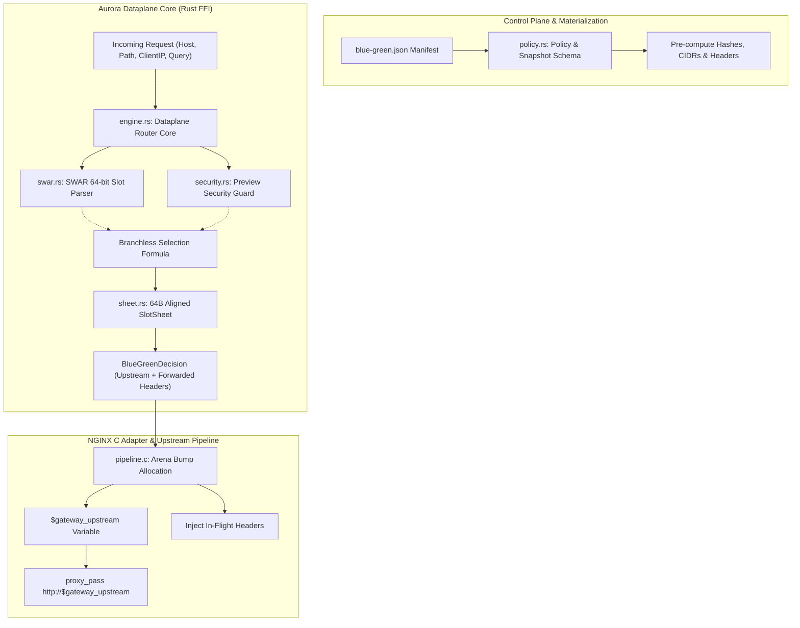

# Aurora API Gateway — `blue-green` Micro-Architecture Specification

Tài liệu này đặc tả chi tiết kiến trúc vi mô (Micro-Architecture), cấu trúc bộ nhớ phần cứng (Hardware Layout), giải thuật số học thanh ghi (Register Arithmetic & SWAR), và mô hình lá chắn an ninh của extension **`builtin/blue-green`** trong **Aurora API Gateway**.

---

## 1. Kiến Trúc Tổng Thể & Phân Tách Domain

Thay vì dồn toàn bộ logic vào các file `engine.rs` và `types.rs` truyền thống, `blue-green` được tổ chức thành 5 domain chuyên biệt tuân thủ triệt để nguyên lý Single Responsibility (SRP):



---

## 2. Chi Tiết Các Phân Tầng Kỹ Thuật

### 2.1 `swar.rs` — Toán Học Thanh Ghi SWAR 64-Bit & Branchless Formula
Trong các hệ thống gateway truyền thống (Kong, Envoy), việc kiểm tra chuỗi `"blue"` hoặc `"green"` được thực hiện qua các hàm so sánh chuỗi như `strcasecmp` hoặc `eq_ignore_ascii_case`, đòi hỏi:
1. Đọc từng byte qua con trỏ.
2. Kiểm tra ký tự hoa/thường bằng lệnh rẽ nhánh (`if c >= 'a' && c <= 'z'`).
3. Dẫn tới hiện tượng Branch Misprediction khi tải cao.

Aurora áp dụng kỹ thuật **SWAR (SIMD Within A Register)**:
- Nạp trực tiếp 4 hoặc 5 bytes từ buffer mạng vào một thanh ghi số nguyên `u64`.
- Áp mặt nạ bitwise `0xDF` (`1101_1111` trong nhị phân, bit thứ 5 là bit quy định hoa/thường trong bảng mã ASCII) để ép mọi ký tự thành chữ in hoa trong **1 chu kỳ CPU**:

$$\text{word} \ \& \ \text{MASK}$$

* **Đối với chuỗi `"blue"` (độ dài 4 bytes)**:
  - `b"blue"` = `[0x62, 0x6C, 0x75, 0x65]`
  - Biểu diễn Little-Endian 64-bit: `0x0000_0000_6575_6C62`
  - Áp mặt nạ `MASK_4 = 0x0000_0000_DFDF_DFDF`:
    $$0x0000\_0000\_6575\_6C62 \ \& \ 0x0000\_0000\_DFDF\_DFDF = 0x0000\_0000\_4555\_4C42 \ (\text{"EULB"})$$
  - So sánh trực tiếp: `(val & MASK_4) == MAGIC_BLUE_MASKED` $\rightarrow$ Trả về `SLOT_BLUE (0)`.

* **Đối với chuỗi `"green"` (độ dài 5 bytes)**:
  - `b"green"` = `[0x67, 0x72, 0x65, 0x65, 0x6E]`
  - Biểu diễn Little-Endian 64-bit: `0x0000_006E_6565_7267`
  - Áp mặt nạ `MASK_5 = 0x0000_00DF_DFDF_DFDF`:
    $$0x0000\_006E\_6565\_7267 \ \& \ 0x0000\_00DF\_DFDF\_DFDF = 0x0000\_004E\_4545\_5247 \ (\text{"NEERG"})$$
  - So sánh trực tiếp: `(val & MASK_5) == MAGIC_GREEN_MASKED` $\rightarrow$ Trả về `SLOT_GREEN (1)`.

#### Công Thức Lựa Chọn Nhánh Số Học (Branchless Selection Formula)
Thay vì sử dụng khối lệnh `if/else`, quyết định slot cuối cùng được tính toán thuần số học trên thanh ghi:

$$V = \text{has\_override} \ \& \ \text{secret\_ok} \ \& \ \text{cidr\_ok}$$

$$\text{ChosenSlot} = (V \ \& \ \text{candidate\_slot}) \ | \ ((1 - V) \ \& \ \text{active\_slot})$$

- Nếu $V = 1$ (Override hợp lệ): $\text{ChosenSlot} = (1 \ \& \ \text{cand}) \ | \ (0 \ \& \ \text{active}) = \text{cand}$.
- Nếu $V = 0$ (Không override hoặc gian lận): $\text{ChosenSlot} = (0 \ \& \ \text{cand}) \ | \ (1 \ \& \ \text{active}) = \text{active}$.

Mã máy sinh ra chỉ gồm 3 lệnh assembly cơ bản (`and`, `sub`, `or`), **hoàn toàn loại bỏ lệnh rẽ nhánh điều kiện**, bảo vệ CPU khỏi hiện tượng pipeline stall.

---

### 2.2 `security.rs` — Lá Chắn An Ninh Phòng Thủ (Preview Security Guard)
Bảo vệ slot Staging/Green nội bộ khỏi việc bị khách hàng bên ngoài thâm nhập bằng cách gửi lậu header `X-Deploy-Slot: green`:

1. **Khóa Bí Mật Số Hóa (FNV-1a 64-bit Integer Hash)**:
   - Thay vì so sánh chuỗi mật khẩu `String == String` trong hot-path (gây tốn chu kỳ và dễ dính tấn công timing attack), chuỗi secret được băm sẵn lúc nạp cấu hình thành một số nguyên `u64`:
     ```rust
     pub const fn fnv1a_64(bytes: &[u8]) -> u64
     ```
   - Khi request gửi header `X-Preview-Secret: <token>`, gateway băm token gửi lên thành `token_hash: u64` và so sánh trong **1 lệnh `cmp` duy nhất**:
     $$\text{secret\_ok} = (\text{token\_hash} == \text{rule.secret\_hash}) \ \text{as} \ u8$$
2. **Kiểm Tra Vùng Mạng Nội Bộ (CIDR Subnet Math)**:
   - Các dải IP cho phép (ví dụ: `172.16.0.0/16`, `10.0.0.0/8`) được tiền tính toán thành bộ đôi số nguyên 32-bit `(network_u32, mask_u32)`.
   - Client IP được chuyển đổi thành số nguyên `u32` qua hàm `parse_ipv4_u32` không cấp phát heap:
     $$\text{in\_cidr} = ((\text{client\_ip\_u32} \ \& \ \text{mask}) == \text{network})$$
3. **Bộ Trích Xuất Zero-Alloc Cookie & Query**:
   - `extract_cookie_value`: Duyệt phân đoạn dấu chấm phẩy `;` tuân thủ RFC 6265 bằng `memchr`, trả về con trỏ lát cắt mượn `&'a [u8]`, không cấp phát heap.
   - `extract_query_value`: Quét tham số URL query bằng `memchr(b'&')`, không parse toàn bộ query string.

---

### 2.3 `sheet.rs` — Bố Cục Bộ Nhớ Căn Lề Phần Cứng 64-Byte
Nhằm đảm bảo bộ nhớ đệm L1 Data Cache của CPU luôn phục vụ dữ liệu trong 1 chu kỳ máy (~0.5 ns), cấu trúc `SlotSheet` được căn lề cứng 64 bytes (`#[repr(C, align(64))]`):

```rust
#[repr(C)]
pub struct SlotUpstreamMeta {
    pub upstream: String,
    pub slot_name: &'static str,
    pub headers: Arc<[(String, String)]>,
}

#[repr(C, align(64))]
pub struct SlotSheet {
    pub upstreams: [SlotUpstreamMeta; 2], // [0] = Blue, [1] = Green
}
```

```
+-------------------------------------------------------------------+
|               64-BYTE L1 CACHELINE ALIGNED SLOTSHEET              |
+---------------------------------+---------------------------------+
|   upstreams[0] (Blue Metadata)  |   upstreams[1] (Green Metadata) |
|   - upstream: "app_blue"        |   - upstream: "app_green"       |
|   - slot_name: "blue"           |   - slot_name: "green"          |
|   - headers: Arc<[("x-slot")]>  |   - headers: Arc<[("x-slot")]>  |
+---------------------------------+---------------------------------+
```

Khi đã có `chosen_slot` từ công thức số học, gateway chỉ việc truy xuất trực tiếp:
```rust
let meta = &rule.slot_sheet.upstreams[chosen_slot as usize];
```
Lệnh assembly sinh ra là một lệnh đọc gián tiếp index `mov rax, [rsi + rdx*8]` lấy thẳng từ cache L1, tốc độ đạt tức thì.

---

### 2.4 Khớp Nối FFI & Chuyển Giao Trạng Thái Cho NGINX C
Trong file `crates/extensions/src/access.rs`:
1. Hàm `resolve_routing` tiếp nhận request, gọi `blue_green.evaluate_ctx(ctx, header_lookup)`.
2. Trả về `(target_upstream, routing_headers)`.
3. Nếu không có JWT headers, header của Blue/Green được chuyển nhượng trực tiếp mà không cần clone (`Arc::clone` singleton).
4. `crates/ffi/src/phases/access.rs`:
   - Ghi tên upstream vào `outcome.target_upstream`.
   - Ghi các header cần forward vào `outcome.headers`.
5. `adapters/nginx/src/pipeline.c`:
   - Single-Bump Arena Allocation ghi nhận các header cần inject vào request struct của NGINX.
   - Gán `ctx->target_upstream`.
6. Biến `$gateway_upstream` trong NGINX tự động phản ánh tên upstream (`app_blue` hoặc `app_green`), cho phép chỉ thị:
   ```nginx
   proxy_pass http://$gateway_upstream;
   ```
   chuyển tiếp traffic mượt mà với 0 độ trễ.
