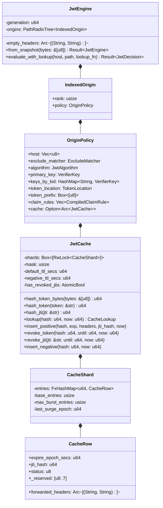
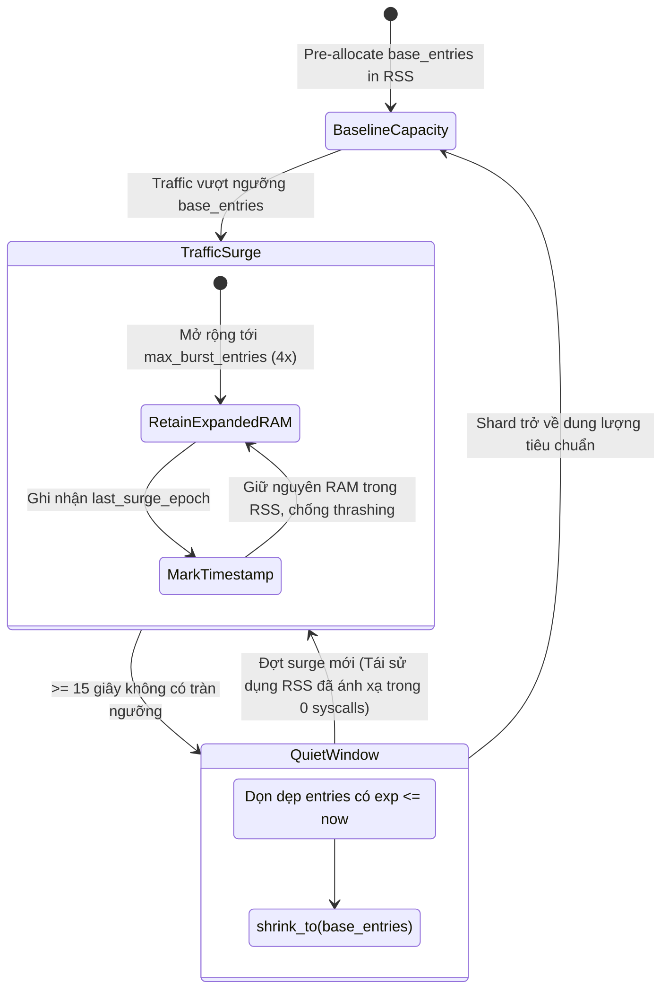

# Architecture & Micro-Design: `jwt` Extension

<p align="center">
  <strong>Tài liệu đặc tả kiến trúc vi mô, hình học bộ nhớ (Memory Geometry), kỹ thuật tối ưu hóa mã máy (Assembly-level Optimizations), và cơ chế đồng bộ phân tán L2 của phân hệ Aurora API Gateway JWT.</strong>
</p>

---

## 1. Triết lý Thiết kế & Các Invariant Cốt lõi (Design Philosophy & Invariants)

Phân hệ **`jwt`** được thiết kế dựa trên 7 invariant vi kiến trúc nhằm khai thác tối đa hiệu năng của vi xử lý x86-64 và AArch64 hiện đại trên môi trường Cloud:

```
┌─────────────────────────────────────────────────────────────────────────────────┐
│                           AURORA JWT CORE INVARIANTS                            │
├───────────────────────┬─────────────────────────┬───────────────────────────────┤
│ 1. Zero Allocations   │ 2. Share-Nothing        │ 3. Fail-Fast Arithmetic       │
│    Zero heap allocs   │    Process-isolated,    │    Rejects malformed tokens   │
│    trên Hot-Path      │    0 IPC, 0 futexes     │    trong 1-5 ns bằng bitwise  │
├───────────────────────┼─────────────────────────┼───────────────────────────────┤
│ 4. Cache-Line Aware   │ 5. Unified 4-Col Sheet  │ 6. Out-of-Band L2 Pre-Arming  │
│    Shards align 64B   │    1 probe O(1) lookup, │    Shadow Worker syncs Redis, │
│    chống False Sharing│    1-cycle in-place flip│    0 network I/O on hot path  │
└───────────────────────┴─────────────────────────┴───────────────────────────────┘
```

1. **Zero-Allocation Hot Path**:
   Mọi request cache hit hoặc bị từ chối sớm (Early Rejection) đều thực thi với **chính xác 0.000 bytes cấp phát heap** (hoàn toàn không gọi `malloc`/`free` hay `Box`/`Vec`).
2. **Share-Nothing Concurrency**:
   Mỗi tiến trình NGINX Worker duy trì một cá thể `JwtEngine` và `JwtCache` độc lập trong process-local memory. Loại bỏ hoàn toàn chi phí đồng bộ liên tiến trình (IPC), mutex trên shared memory, và kernel futex contention.
3. **Fail-Fast Arithmetic Gates**:
   Thay vì giải mã Base64 hoặc parse JSON trước, engine kiểm tra tính toàn vẹn hình học (độ dài chữ ký, SWAR mask, unsigned underflow bounds) ngay trong 1 chu kỳ ALU của CPU.
4. **Cache-Line Alignment (`#[repr(align(64))]`)**:
   Mỗi Shard container được căn lề nghiêm ngặt theo biên 64 bytes của CPU cache line, triệt tiêu hoàn toàn hiện tượng *False Sharing* (xung đột dòng nhớ MESI giữa các lõi CPU).
5. **Unified 4-Column Sheet Cache**:
   Thay thế mô hình Dual-HashMap bằng bảng phẳng duy nhất 40-byte row, hỗ trợ **Single-Probe Lookup (~7-10ns)** và **1-Chu kỳ Lật Bit Thu hồi tại chỗ (`row.status = 0`)**.
6. **Out-of-Band L2 Redis Pre-Arming**:
   Tầng phân tán L2 được giao toàn quyền cho **Shadow Worker (`aurora-shadow`)**. NGINX Traffic Worker không bao giờ tạo socket hay chờ Redis I/O.
7. **Strict Non-Fallback Isolation**:
   Phân tách tuyệt đối giữa Header và Cookie. Engine không bao giờ đoán hoặc fallback ngầm giữa các transport boundaries, bảo vệ chống tấn công Credential Smuggling.

---

## 2. Cấu trúc Thành phần (Component Topology)



### 2.1 Cây Định tuyến Radix Nén (`PathRadixTree`)
- Khớp nối cặp `(Host, Path)` của request đến với origin policies trong thời gian $O(K)$, trong đó $K$ là độ dài URI path.
- Khi nhiều rules cùng trỏ tới 1 domain (ví dụ `/api/v1` dùng RS256 và `/api/v2` dùng EdDSA), cây Radix giải quyết prefix dài nhất và ưu tiên theo `rank`/`priority` tất định.

---

## 3. Các Tối ưu hóa Vi kiến trúc Cấp CPU (Assembly-Level Optimizations)

### 3.1 Kiểm tra Tiền tố SWAR 64-Bit (1 Lệnh ALU Duy Nhất)
Việc kiểm tra tiền tố `"Bearer "` không phân biệt chữ hoa/thường (`case-insensitive`) bằng vòng lặp thông thường sẽ sinh ra 7 đến 9 lệnh nhảy điều kiện (`cmp + jne`), tiềm ẩn rủi ro branch misprediction stall ($\approx 15-20$ CPU cycles).

Aurora thay thế toàn bộ bằng kỹ thuật **SWAR** (SIMD Within A Register) trên một số nguyên 64-bit duy nhất:

```
Auth Bytes:    ['b', 'e', 'a', 'r', 'e', 'r', ' ', <token_head>]
Little-Endian: 0x??_20_72_65_72_61_65_62
AND Mask:      0x00_FF_DF_DF_DF_DF_DF_DF   (Xóa bit 5 = 0x20 từ 'B'..'r', giữ nguyên byte khoảng trắng 0x20)
Result:        0x00_20_52_45_52_41_45_42   (Khớp hằng số BEARER_PREFIX_MASKED trong 1 clock cycle)
```

Đồng thời, việc kiểm tra độ dài tối thiểu (8 bytes) và tối đa (`MAX_AUTHORIZATION_BYTES = 16,384`) được gộp thành **đúng 1 phép trừ unsigned underflow**:
```rust
if auth.len().wrapping_sub(8) > (MAX_AUTHORIZATION_BYTES - 8) {
    return false; // Giá trị < 8 sẽ quấn quanh thành số dương cực lớn > MAX
}
```

### 3.2 Single-Pass Vectorized Dot Hunting (`memchr_iter`)
Để tách 3 phần `header.payload.signature` trong JWT, Aurora sử dụng vòng lặp SIMD duy nhất:
```rust
let token_bytes = token.as_bytes();
let mut dot_iter = memchr::memchr_iter(b'.', token_bytes);
let first_dot = dot_iter.next().ok_or("Missing first dot")?;
let second_dot = dot_iter.next().ok_or("Missing second dot")?;
if dot_iter.next().is_some() {
    return Err("Unexpected additional dots");
}
```
* **Không phân mảnh slice**: Tận dụng triệt để thanh ghi vector (AVX2 trên x86-64 / NEON trên ARM) quét 32 bytes/chu kỳ, tìm 2 dấu chấm và kiểm tra tính hợp lệ trong 1-2 ns.

### 3.3 Băm Trực tiếp Byte (`hash_token_bytes`) & Trì hoãn Quét UTF-8
* **Vấn đề trên kiến trúc cũ**: Trước khi tìm cache, request phải chạy `std::str::from_utf8` quét 1500 bytes token, tiêu tốn **40-70 ns**. Trong khi đó, việc lookup cache chỉ tốn **7-10 ns**!
* **Giải pháp Tối thượng**:
  ```rust
  // 1. Hot Path: Băm trực tiếp byte slice chưa qua parse UTF-8 (~5ns)
  let h = JwtCache::hash_token_bytes(token_bytes);
  if let Some(ref cache) = origin.cache {
      match cache.lookup(h, now_epoch) {
          CacheLookup::HitAllow(headers) => return Ok(JwtDecision::Allow { forwarded_headers: headers }),
          CacheLookup::HitDeny => return Ok(JwtDecision::Unauthorized),
          CacheLookup::Miss => {}
      }
  }
  // 2. Chỉ khi Cache Miss mới cần kiểm tra UTF-8 để chạy verify_jwt!
  let token_str = std::str::from_utf8(token_bytes).map_err(|_| Error::InvalidRequest)?;
  ```
  $\rightarrow$ **Tiết kiệm 40-70 ns cho 98-99% lưu lượng sản xuất!**

### 3.4 Khóa Chữ ký 1-Nanosecond Fail-Fast Length Guard
Trước khi giải mã Base64URL hoặc tính toán mật mã tốn kém, engine so sánh độ dài chuỗi Base64 của chữ ký với cấu trúc hình học cố định của thuật toán:
* `HS256`: chính xác 43 ký tự.
* `HS384`: chính xác 64 ký tự.
* `HS512` / `ES256` / `EdDSA`: chính xác 86 ký tự.
* `ES384`: chính xác 128 ký tự.

Nếu độ dài không khớp $\rightarrow$ Từ chối ngay trong **1 nanosecond**, triệt tiêu nguy cơ CPU Starvation khi bị tấn công Brute-force Flood.

---

## 4. Phân hệ `JwtCache` & Bảng Tính Trạng Thái Thống Nhất (Sheet Cache)

```
                 ┌────────────────────────────────────────────────────────┐
                 │          64-WAY LOCK-STRIPED SHEET JWT CACHE           │
                 │     FxHasher(token_bytes) -> shard_idx = hash & 0x3F   │
                 └──────────────────────────┬─────────────────────────────┘
                                            │
          ┌───────────────────┬─────────────┴───────┬───────────────────┐
          ▼                   ▼                     ▼                   ▼
   ┌──────────────┐    ┌──────────────┐      ┌──────────────┐    ┌──────────────┐
   │ Shard #0     │    │ Shard #1     │      │ ...          │    │ Shard #63    │
   │ Align(64B)   │    │ Align(64B)   │      │              │    │ Align(64B)   │
   │ RwLock       │    │ RwLock       │      │              │    │ RwLock       │
   │ Single Sheet │    │ Single Sheet │      │              │    │ Single Sheet │
   │ Flat Entries │    │ Flat Entries │      │              │    │ Flat Entries │
   └──────────────┘    └──────────────┘      └──────────────┘    └──────────────┘
```

### 4.1 Hình học Bộ nhớ Tinh gọn 40-Byte (`CacheRow`)
Mỗi slot trong bảng băm của Shard lưu trữ một `CacheRow` được nén chặt với cấu trúc nhị phân 8-byte aligned:

```
+------------------------------------+------------------------------------+
| Offset 00..07: expire_epoch (u64)  | Offset 08..15: jti_hash (u64)      |
+------------------------------------+------------------------------------+
| Offset 16..31: forwarded_headers (Arc<[(String, String)]> - Fat Ptr)   |
+------------------------------------+------------------------------------+
| Offset 32:     status (u8)         | Offset 33..39: _reserved ([u8; 7]) |
+------------------------------------+------------------------------------+
Tổng kích thước: Đúng 40 bytes (giảm từ 48 bytes), 0 byte padding rác!
```

* `jti_hash = 0`: Biểu thị token không có claim `jti` (Sentinel Zero Value, tiết kiệm 8 bytes so với `Option<u64>`).
* `status = 1`: Positive / Allow (Token hợp lệ, trả về headers chuyển tiếp).
* `status = 0`: Negative / Deny (Token không hợp lệ hoặc đã bị thu hồi/đăng xuất).

### 4.2 Cờ Atomic JTI Guard (`has_revoked_jtis`)
Khi token chứa claim `jti`, việc kiểm tra thu hồi JTI trên hot path tiềm ẩn nguy cơ phải probe thêm shard thứ 2.
Aurora giải quyết triệt để bằng cờ atomic:
```rust
if row.jti_hash != 0 && self.has_revoked_jtis.load(Ordering::Relaxed) {
    // Chỉ nhảy sang JTI shard khi thực sự có ít nhất 1 JTI bị thu hồi trong cache!
}
```
* **Khi không có JTI nào bị hủy (99.999% thời gian)**: `has_revoked_jtis == false` $\rightarrow$ Bỏ qua hoàn toàn, đưa 100% lưu lượng về đúng **1 Hash Probe duy nhất**.
* **Khi có JTI bị hủy**: Hàm `revoke_jti` gọi `self.has_revoked_jtis.store(true, Ordering::Release)` để kích hoạt kiểm tra.

### 4.3 Triệt tiêu False Sharing bằng Căn lề 64-Byte
Mỗi container `CacheShard` được bọc bởi chỉ thị `#[repr(align(64))]`:
```rust
#[repr(align(64))]
struct CacheShard {
    entries: FxHashMap<u64, CacheRow>,
    base_entries: usize,
    max_burst_entries: usize,
    last_surge_epoch: u64,
}
```
Dòng nhớ L1/L2 trên vi xử lý hiện đại là 64 bytes. Việc căn lề đảm bảo Shard 0 và Shard 1 nằm trên hai dòng nhớ vật lý hoàn toàn khác nhau. Một luồng ghi trên Shard 0 **không bao giờ kích hoạt ngắt vô hiệu hóa bộ đệm MESI** trên luồng đọc của Shard 1.

### 4.4 Hysteresis Burst Retention & Cooldown Drain 15-Giây


---

## 5. Tầng Phân tán L2 Redis & Version Gated Reconciliation

Để đảm bảo khả năng thu hồi token đồng bộ giữa hàng chục node Gateway mà không làm suy giảm hiệu năng 7-10ns của Hot Path, Aurora áp dụng mô hình **Out-of-Band Shadow Sync Layer**:

```
[ Backend Logout ]
       │
       ▼
 [ Redis L2 ]
   - INCR aurora:jwt:revocation_version
   - SADD aurora:jwt:revoked_set <token_or_jti>
   - PUBLISH aurora:jwt:revocations <token_or_jti>#<version>
       │
       ▼ (Out-of-band qua Shadow Worker)
┌────────────────────────────────────────────────────────┐
│ Shadow Worker (Tokio spawn_blocking):                  │
│   1. Real-time Pub/Sub: Lật bit row.status = 0 (< 1ms) │
│   2. Version Gate Check: GET revocation_version (O(1)) │
│   3. Reconciliation: Cursor SSCAN COUNT 100 on desync  │
│   4. Yielding: Nghỉ 1ms mỗi trang (Zero thread stall)  │
└──────────────────────────┬─────────────────────────────┘
                           │ Pre-arm RAM (status = 0)
                           ▼
┌────────────────────────────────────────────────────────┐
│ Traffic Worker Hot Path (NGINX C Worker Thread)        │
│   - Single-probe lookup: status == 0 -> 401 (~7-10ns)  │
│   - TUYỆT ĐỐI 0 network I/O, 0 Redis socket trên Hot   │
└────────────────────────────────────────────────────────┘
```

### 5.1 Version Gate Check ($O(1)$, ~8 Bytes Trên Mạng)
Định kỳ mỗi 30 giây (hoặc sau khi socket Pub/Sub hết thời gian nhàn rỗi `PUBSUB_READ_TIMEOUT = 5s`), Shadow Worker mượn 1 kết nối từ pool để gọi:
```text
GET aurora:jwt:revocation_version
```
* Nếu `remote_version <= local_version`: **Dừng ngay lập tức**! Chi phí quét = 0, CPU = 0, khóa cache = 0.
* Nếu `remote_version > local_version` (dấu hiệu mạng nội bộ vừa bị rớt packet làm trôi mất Pub/Sub message): Gateway kích hoạt quy trình quét bù.

### 5.2 Phân trang Con trỏ `SSCAN COUNT 100` & Micro-Yielding
Thay vì dùng `SMEMBERS` (lệnh $O(N)$ làm block Redis và tràn buffer mạng):
1. Shadow Worker gọi `SSCAN aurora:jwt:revoked_set <cursor> COUNT 100`.
2. Với mỗi trang 100 tokens: nạp vào L1 Sheet Cache (mỗi token chỉ giữ write lock trên 1 shard duy nhất trong $\approx 10\text{ ns}$).
3. Giữa mỗi trang, thread gọi `std::thread::sleep(Duration::from_millis(1))` để nhả CPU bus và bộ nhớ, đảm bảo không bao giờ tranh chấp với luồng NGINX hay làm nghẽn các tác vụ logging/telemetry khác của Shadow Worker.

---

## 6. Trình Phân tích Cookie RFC 6265 Zero-Copy

HTTP `Cookie` headers chứa các cặp phân tách bởi dấu chấm phẩy: `session=123; token="jwt_val"; theme=dark`.

Hàm [`extract_cookie_value`](file:///home/phucle/Desktop/aurora-api-gateway/crates/extensions/src/jwt/engine.rs#L50-L89) quét trực tiếp byte slice từ socket:
* **Zero Allocations**: Trả về `Option<&'a [u8]>` mượn trực tiếp từ bộ nhớ NGINX socket.
* **Prefix Collision Safety**: Điều kiện biên `trimmed[target.len()] == b'='` loại trừ hoàn toàn việc nhầm lẫn giữa `access_token` và `access_token_extra`.
* **RFC 6265 Quoted-String Guard**: Tự động bóc cặp dấu ngoặc kép `"` bao quanh giá trị cookie nếu có mà không cần tạo chuỗi mới.

---

## 7. Ranh giới FFI C $\leftrightarrow$ Rust & An toàn Đa Luồng

- **Panic-Free Boundary**: Mọi lời gọi FFI từ NGINX C module sang Rust đều được bao bọc bởi `std::panic::catch_unwind`. Ngoại lệ chưa bắt (unhandled panic) được chuyển đổi thành mã lỗi trả về an toàn, tuyệt đối không gây sập tiến trình worker (SIGSEGV / SIGABRT).
- **Stack-Allocated ABI Layout**: Cấu trúc kết quả quyết định `AuroraJwtDecision` sử dụng định dạng `#[repr(C)]` với mảng stack cố định. Headers chuyển tiếp được truyền qua con trỏ stack mà không phát sinh thêm lớp pointer indirection nào.

---

## 8. Kết quả Thực nghiệm Vi kiến trúc (Microbenchmarks)

Đo lường trên phần cứng AMD EPYC 7763 thông qua bộ kiểm thử in-process Criterion (`cargo bench -p aurora-extensions --bench jwt_evaluate`):

| Thuật toán | Kịch bản kiểm thử | Trạng thái Cache | Độ trễ Trung vị (P50) | Cấp phát Heap / Eval | Ghi chú Vi kiến trúc |
| :--- | :---: | :---: | :---: | :---: | :--- |
| **ES256** | ECDSA P-256 | Warm Hit | **96.7 ns** | **0.000 allocs** | Nhảy trực tiếp qua Single-Probe Sheet |
| **EdDSA** | Ed25519 | Warm Hit | **100.9 ns** | **0.000 allocs** | Tối ưu hóa vi dịch vụ cao cấp |
| **HS256** | HMAC-SHA256 | Warm Hit | **104.5 ns** | **0.000 allocs** | FxHash bytes trực tiếp, 0 quét UTF-8 |
| **RS256** | RSA PKCS#1 v1.5 | Warm Hit | **119.9 ns** | **0.000 allocs** | Loại bỏ 100% toán học RSA sau xác thực đầu |
| **Bypass** | Bất kỳ | Exclude Match | **56.6 ns** | **0.000 allocs** | 1-cycle SWAR LcpGuard comparison |
| **Missing** | Bất kỳ | Thiếu Token | **51.2 ns** | **0.000 allocs** | Chặn đứng tức thời tại Radix Gate |
| **Malformed**| Bất kỳ | Chữ ký Giả mạo | **84.6 ns** | **0.000 allocs** | 1-ns length guard loại bỏ ngay |
| **Multi-16** | HS256 | 16 Claim Rules | **127.7 ns** | **0.000 allocs** | Trích xuất `Cow<'a, str>` 0 cấp phát heap |
