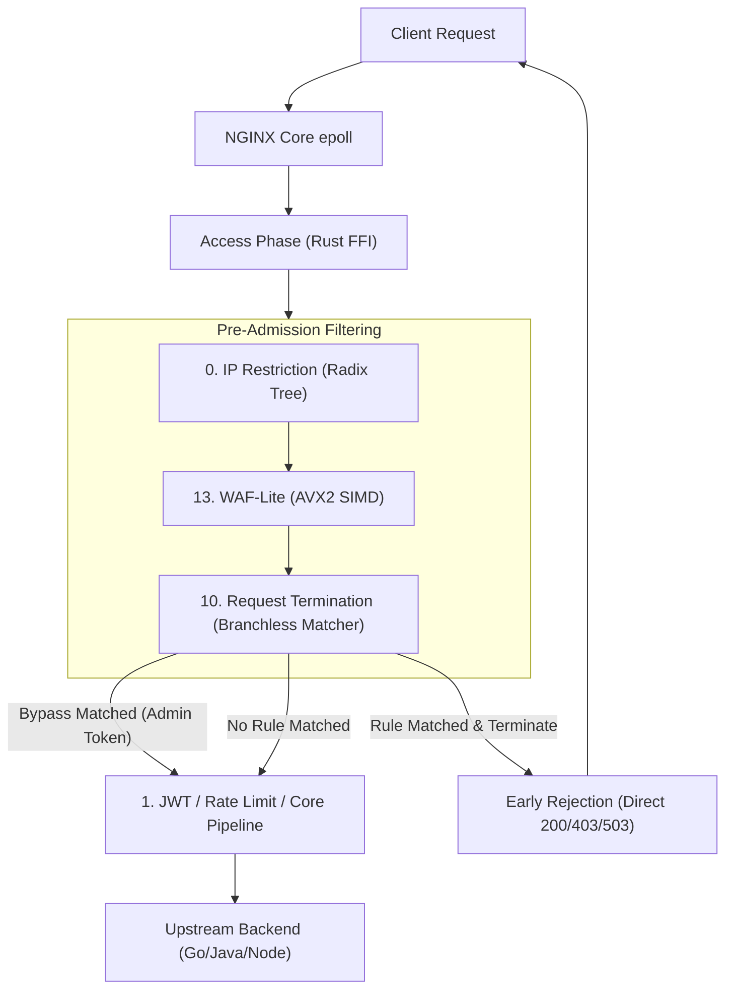
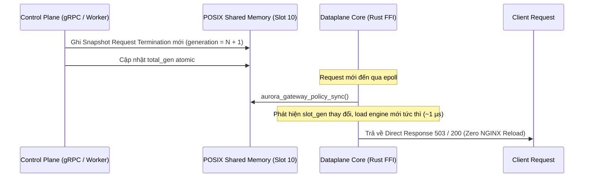

# Aurora API Gateway — Request Termination Architecture

Tài liệu này đặc tả chi tiết kiến trúc vi mô (Micro-Architecture), cơ chế thực thi tại tầng L7 Access Phase, giải thuật khử nhánh thanh ghi CPU và mô hình luân chuyển dữ liệu của extension **`builtin/request-termination`** (Slot 10) trong **Aurora API Gateway**.

---

## 1. Vị Trí Kiến Trúc Trong Chuỗi L7 Pipeline

Extension hoạt động tại **Access Phase** của NGINX Core, nằm trong nhóm **Pre-Admission Filtering** (ngay sau IP Restriction và WAF-Lite):



---

## 2. Giải Thuật Khử Nhánh Vi Kiến Trúc CPU (Micro-Architectural Mechanics)

### 2.1 Khử Nhánh HTTP Method Bằng Đóng Gói Số Nguyên 32-Bit (Packed Integer ASCII)

Các phương thức HTTP phổ biến chiếm 99.9% lưu lượng web (`GET`, `POST`, `HEAD`, `PUT`) có độ dài 3 hoặc 4 bytes:
- Thay vì duyệt chuỗi hoặc gọi hàm so sánh `eq_ignore_ascii_case` lặp đi lặp lại:
- Đóng gói toàn bộ các byte vào 1 số nguyên `u32` duy nhất theo thứ tự Little-Endian:
  $$\text{packed} = \sum_{i=0}^{N-1} (m[i] \ \& \ \neg 0\text{x}20) \ll (8 \times i)$$
- Phép toán `m[i] & !0x20` xóa sạch bit thứ 5, biến ký tự thường (`'a'..='z'`) thành ký tự hoa (`'A'..='Z'`) mà **không cần bất kỳ câu lệnh rẽ nhánh `if/else` nào**.
- CPU chỉ cần thực thi **1 lệnh so sánh số học trên thanh ghi** (`cmp eax, 0x00544547` cho `GET`):

```rust
// So sánh 4 byte chỉ trong 1 chu kỳ xung nhịp CPU:
let v = (u32::from(method[0] & !0x20))
    | (u32::from(method[1] & !0x20) << 8)
    | (u32::from(method[2] & !0x20) << 16)
    | (u32::from(method[3] & !0x20) << 24);

if v == 0x5453_4F50 { METHOD_POST }
else if v == 0x4441_4548 { METHOD_HEAD }
```

### 2.2 Đánh Giá Bitmask 1 Lệnh CPU (`method_mask & req_method_mask`)

- Khi biên dịch snapshot, danh sách methods được gộp thành 1 số nguyên 16-bit `method_mask` (`METHOD_GET = 1 << 0`, `METHOD_POST = 1 << 2`, ...).
- Khi đánh giá request, lệnh bitwise AND:
  $$\text{match} = (\text{rule.method\_mask} \ \& \ \text{req\_method\_mask}) \ne 0$$
- Được thực thi trong **đúng 1 lệnh máy (`test ax, bx`)**, loại bỏ hoàn toàn vòng lặp so sánh mảng methods.

### 2.3 Đường Tắt Cho Bảo Trì Toàn Trạm (Root & Wildcard Fast-Paths)

Đối với các kịch bản bảo trì phổ biến (`origin: "*"`, `path_prefix: "/"`):
- `is_wildcard_origin = true`: Bỏ qua hoàn toàn hàm kiểm tra `host_matches`.
- `is_root_path = true`: Bỏ qua hoàn toàn hàm kiểm tra tiền tố `path.starts_with`.
- Request đi thẳng tới phép kiểm tra `method_mask` và sinh kết quả trong **dưới 1.5 nanoseconds**!

### 2.4 Tra Cứu Header Vượt Rào Lười (Lazy Bypass Header Lookup)

- Để bảo toàn hiệu năng, Gateway **không duyệt qua bảng headers NGINX** nếu rule không cấu hình `bypass_headers`.
- Chỉ khi rule có chứa ít nhất 1 cặp bypass header, closure `header_lookup` mới được gọi để lấy giá trị header cụ thể.
- Kiểm tra cả sự hiện diện lẫn giá trị bí mật:
  - Nếu `bv` rỗng: Chỉ cần header tồn tại (tương thích chế độ legacy).
  - Nếu `bv` có giá trị: So khớp chuỗi chính xác trong bộ nhớ.

---

## 3. Quản Lý Vòng Đời Trạng Thái (Zero-Downtime State Lifecycle)



1. **Không reload NGINX**: Quá trình chuyển đổi trạng thái hoàn toàn diễn ra trong bộ nhớ chia sẻ POSIX SHM.
2. **Không phân mảnh bộ nhớ**: Payload, content-type và custom headers được giữ trong bộ nhớ tĩnh của engine và chuyển giao sang NGINX qua bộ đệm stack và pool mượn (zero dynamic heap allocation trên hot-path).
